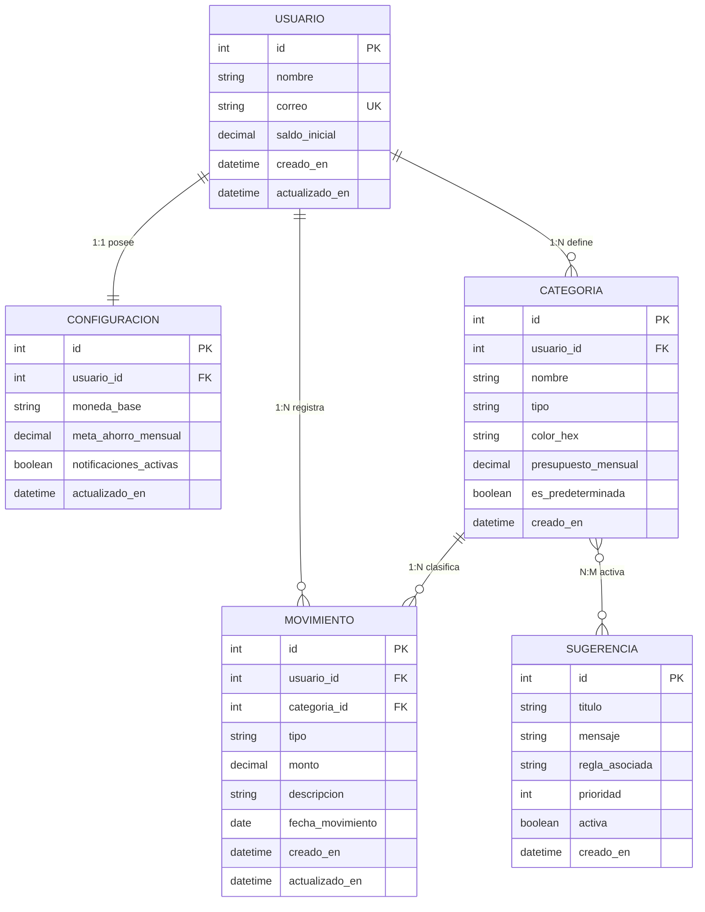
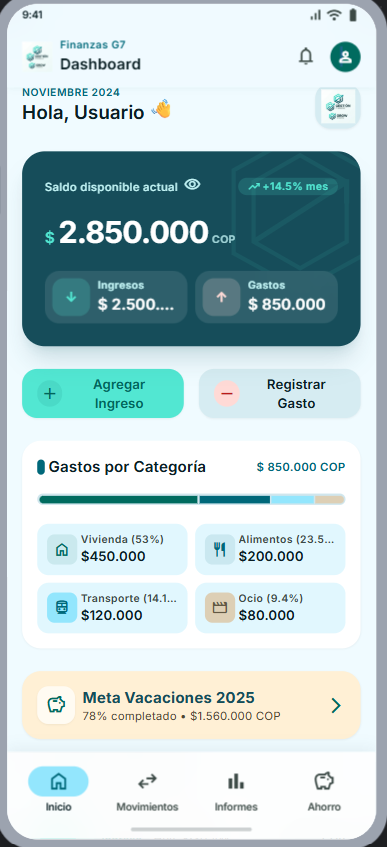
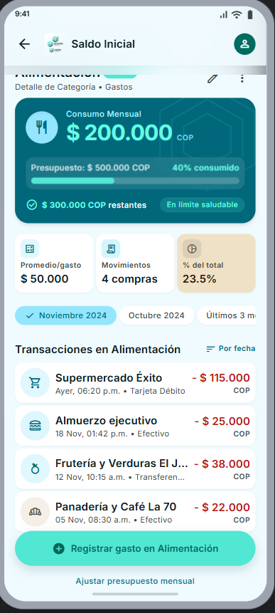
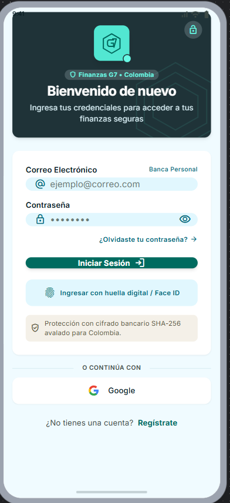
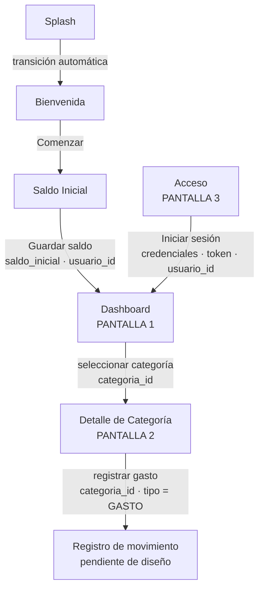
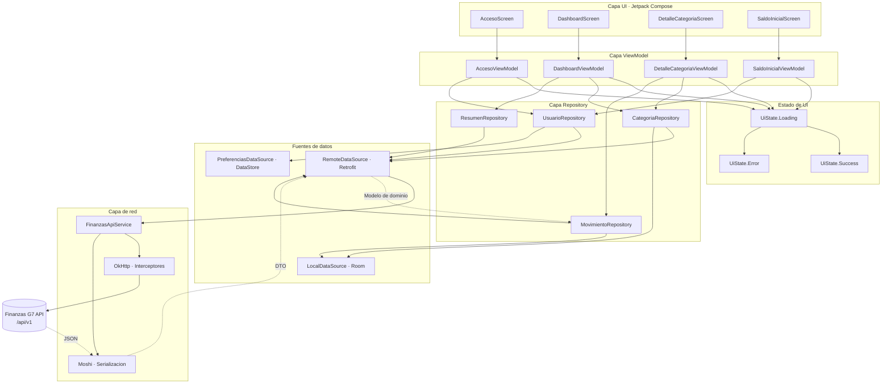

<div align="center">

# Proyecto Integrador Móviles G7

### Aplicación móvil para la gestión y análisis de finanzas personales

[](https://developer.android.com/)
[](https://kotlinlang.org/)
[](https://developer.android.com/compose)
[](https://gradle.org/)
[](#api-propia-finanzas-g7-api)
[](https://github.com/JuanEstebanLT/proyectointegradormoviles-g7)

</div>

---

## Descripción

Proyecto Integrador Móviles G7 es una aplicación móvil Android planificada para apoyar el control manual de las finanzas personales. Permitirá registrar un saldo inicial, ingresos, gastos y categorías, y utilizar esa información para consultar el saldo disponible, revisar el historial financiero y analizar la distribución de los movimientos.

El producto también contempla sugerencias educativas de ahorro obtenidas mediante reglas sencillas y explicables aplicadas exclusivamente a la información registrada por la persona usuaria.

La aplicación consumirá una **API REST propia**, diseñada y desarrollada por el mismo equipo, que expone los recursos del dominio financiero. La aplicación móvil actúa como cliente de esa API.

> [!IMPORTANT]
> Las funcionalidades descritas en este documento corresponden al alcance planificado del MVP. La implementación, las pruebas de ejecución y la publicación de una versión estable continúan pendientes. La API propia se encuentra en fase de diseño: su modelo de datos está definido, pero no ha sido implementada ni desplegada.

## Objetivo

Permitir que una persona lleve control manual de su dinero registrando saldo inicial, ingresos y gastos, para consultar posteriormente su situación financiera, historial, distribución de gastos e informes, junto con orientaciones educativas básicas sobre hábitos de ahorro.

## Tabla de contenido

- [Funcionalidades planificadas](#funcionalidades-planificadas)
- [Alcance del MVP](#alcance-del-mvp)
- [Fuera del alcance](#fuera-del-alcance)
- [API propia: Finanzas G7 API](#api-propia-finanzas-g7-api)
- [Modelo de datos (Diagrama ER)](#modelo-de-datos-diagrama-er)
- [Diseño de pantallas y flujo de navegación](#diseño-de-pantallas-y-flujo-de-navegación)
- [Arquitectura y consumo de la API](#arquitectura-y-consumo-de-la-api)
- [Tecnologías](#tecnologías)
- [Estado actual del proyecto](#estado-actual-del-proyecto)
- [Historias de Usuario](#historias-de-usuario)
- [Gestión del proyecto](#gestión-del-proyecto)
- [Flujo de trabajo](#flujo-de-trabajo)
- [Equipo](#equipo)
- [Estrategia de ramas](#estrategia-de-ramas)
- [Convención de commits](#convención-de-commits)
- [Estructura documental](#estructura-documental)
- [Requisitos de desarrollo](#requisitos-de-desarrollo)
- [Instalación y clonación](#instalación-y-clonación)
- [Compilación básica](#compilación-básica)
- [Colaboración](#colaboración)
- [Enlaces del proyecto](#enlaces-del-proyecto)

## Funcionalidades planificadas

El MVP contempla las siguientes capacidades:

- Registrar un saldo inicial como referencia financiera.
- Registrar ingresos y actualizar el saldo disponible.
- Registrar gastos y descontarlos del saldo.
- Clasificar movimientos mediante categorías.
- Consultar el saldo, los ingresos y los gastos acumulados.
- Consultar y filtrar el historial de movimientos.
- Visualizar informes de ingresos, gastos y categorías.
- Recibir sugerencias educativas de ahorro basadas en los movimientos registrados.
- Editar y eliminar movimientos, conservando la consistencia de los cálculos.
- Sincronizar la información registrada con la API propia del proyecto.

## Alcance del MVP

La primera versión funcional se enfoca en el registro manual y la consulta de información financiera personal dentro de la aplicación. El alcance comprende:

| Área | Alcance planificado |
|---|---|
| Registro financiero | Saldo inicial, ingresos y gastos |
| Organización | Categorías para clasificar movimientos |
| Consulta | Resumen financiero e historial |
| Análisis | Totales, períodos y distribución de gastos por categoría |
| Mantenimiento | Edición y eliminación de movimientos |
| Educación financiera | Sugerencias de ahorro simples, comprensibles y no profesionales |
| Integración | Consumo de la API REST propia del equipo |

## Fuera del alcance

El MVP actual no contempla:

- Integración bancaria o conexión automática con entidades financieras.
- Pagos o transferencias desde la aplicación.
- Créditos, inversiones o criptomonedas.
- Recomendación de productos financieros.
- Asesoría financiera profesional.
- Consumo de APIs de terceros ajenas al proyecto.

Las sugerencias de ahorro tendrán un propósito exclusivamente educativo y se basarán en patrones simples de los movimientos registrados.

> [!NOTE]
> La exclusión de servicios externos se mantiene. La API consumida por la aplicación es propia del equipo y forma parte del alcance del proyecto, no una integración de terceros.

## API propia: Finanzas G7 API

La aplicación consumirá una API REST diseñada y desarrollada por el equipo, que expone el dominio financiero del producto. Esta decisión corresponde a la opción de *API propia* contemplada en la Fase 1 del proyecto integrador.

### Justificación

El dominio de la aplicación es información **generada por la persona usuaria**: sus movimientos, sus categorías y su saldo. Ninguna API pública puede proveer ese dato. Desarrollar la API propia permite que el modelo expuesto coincida exactamente con las Historias de Usuario ya definidas, sin adaptar el producto a un contrato ajeno.

### Por qué el problema amerita una aplicación móvil

1. **Momento de captura.** El movimiento se registra donde ocurre, no al final del día. El dispositivo móvil es el único que acompaña a la persona en ese momento.
2. **Frecuencia de uso.** El control financiero personal exige interacciones cortas y repetidas, propias de un dispositivo siempre disponible.
3. **Datos personales.** La información financiera es sensible y se consulta de forma individual, no compartida.
4. **Consulta inmediata.** El saldo disponible debe poder verificarse antes de decidir un gasto.

### Información base

| Elemento | Valor |
|---|---|
| Nombre | Finanzas G7 API |
| Estilo | REST sobre HTTPS |
| Formato de intercambio | JSON |
| Versionado | Prefijo de ruta `/api/v1` |
| URL base | `https://<host-de-despliegue>/api/v1` *(pendiente de despliegue)* |
| Autenticación | Por definir en TT-01 |

> [!WARNING]
> La URL base es un marcador de posición. La API no ha sido desplegada. Debe sustituirse por el dominio real una vez el despliegue sea verificado.

### Recursos expuestos

La API expone cuatro recursos principales, correspondientes a las cuatro entidades del modelo de datos:

| # | Recurso | Endpoint base | Métodos previstos | HU relacionadas |
|---|---|---|---|---|
| 1 | Usuario | `/api/v1/usuarios` | `GET`, `POST`, `PUT` | HU-01 |
| 2 | Categoría | `/api/v1/categorias` | `GET`, `POST`, `PUT`, `DELETE` | HU-04 |
| 3 | Movimiento | `/api/v1/movimientos` | `GET`, `POST`, `PUT`, `DELETE` | HU-02, HU-03, HU-06, HU-09 |
| 4 | Sugerencia | `/api/v1/sugerencias` | `GET` | HU-08 |

Recursos complementarios:

| Recurso | Endpoint base | Métodos | Naturaleza |
|---|---|---|---|
| Configuración | `/api/v1/usuarios/{id}/configuracion` | `GET`, `PUT` | Subrecurso en relación 1:1 con Usuario |
| Resumen | `/api/v1/resumen` | `GET` | Recurso derivado; no corresponde a una entidad persistida |

El recurso **Resumen** expone totales calculados a partir de los movimientos registrados. No constituye una entidad del modelo y por tanto no se contabiliza entre los cuatro recursos exigidos.

### Stack propuesto para la API

> [!NOTE]
> Las siguientes tecnologías constituyen una **propuesta sujeta a evaluación**, no una decisión aprobada. Su aprobación formal corresponde a la tarea técnica TT-01.

| Componente | Propuesta | Motivo |
|---|---|---|
| Lenguaje y framework | Node.js con Express | Curva de aprendizaje baja y familiaridad previa del equipo |
| Base de datos | MySQL | Modelo relacional coherente con el diagrama ER |
| Despliegue | Servicio PaaS con plan gratuito | Requisito de accesibilidad pública de la Fase 1 |

### Seguridad

Las credenciales de la API, cadenas de conexión y claves de despliegue no deben incluirse en el repositorio. En la aplicación Android, la URL base y cualquier token se gestionarán mediante `local.properties` y se expondrán a través de `BuildConfig`. El archivo `local.properties` permanece excluido por `.gitignore`.

## Modelo de datos (Diagrama ER)

El siguiente diagrama representa las entidades principales, sus atributos clave y las cardinalidades entre ellas.




### Cardinalidades

| Relación | Notación Mermaid | Tipo | Lectura |
|---|---|---|---|
| Usuario — Configuración | `\|\|--\|\|` | **1:1** | Cada usuario posee exactamente una configuración |
| Usuario — Categoría | `\|\|--o{` | **1:N** | Un usuario define cero o muchas categorías |
| Usuario — Movimiento | `\|\|--o{` | **1:N** | Un usuario registra cero o muchos movimientos |
| Categoría — Movimiento | `\|\|--o{` | **1:N** | Una categoría clasifica cero o muchos movimientos |
| Categoría — Sugerencia | `}o--o{` | **N:M** | Una categoría puede activar varias sugerencias y una sugerencia puede aplicarse a varias categorías |

### Nota de implementación

La relación **N:M** entre `CATEGORIA` y `SUGERENCIA` se resuelve en la base de datos mediante una tabla intermedia `sugerencia_categoria`, con las claves foráneas `categoria_id` y `sugerencia_id` conformando la clave primaria compuesta. Esta tabla no se representa como entidad en el diagrama porque no aporta atributos propios al modelo conceptual.

El campo `tipo` en `CATEGORIA` y `MOVIMIENTO` admite los valores `INGRESO` y `GASTO`. La consistencia entre el tipo del movimiento y el de su categoría debe validarse en la capa de servicio de la API.

## Diseño de pantallas y flujo de navegación

El prototipo de interfaz fue elaborado con **Google Stitch**.

**Proyecto interactivo:** [Finanzas G7 — Prototipo en Google Stitch](https://stitch.withgoogle.com/preview/12478822216412901322?node-id=7d4f7b7b00ad42a0af3af3ec48ea438e)

> [!NOTE]
> Las tres pantallas requeridas por la Fase 3 se encuentran diseñadas. El prototipo incluye además tres pantallas complementarias de inicio y configuración inicial.

### Identidad visual

| Elemento | Definición |
|---|---|
| Nombre comercial | Finanzas G7 |
| Eslogan | Control inteligente de tu dinero |
| Color primario | Verde azulado oscuro (teal) |
| Color de acento | Turquesa |
| Moneda | Peso colombiano (COP) |
| Navegación principal | Barra inferior de cuatro destinos: Inicio, Movimientos, Informes, Ahorro |

### Pantallas requeridas

#### Pantalla 1 — Dashboard (lista principal)



| Aspecto | Descripción |
|---|---|
| Información que muestra | Saludo y período activo, saldo disponible con variación porcentual mensual, totales de ingresos y gastos, y la **lista de categorías de gasto**, cada una con su monto y su porcentaje de participación como indicador de estado. Incluye además una tarjeta de meta de ahorro |
| Endpoints consumidos | `GET /api/v1/resumen` para saldo, ingresos y gastos totales; `GET /api/v1/categorias` para los nombres, colores e iconos de la lista; `GET /api/v1/usuarios/{id}/configuracion` para la meta de ahorro |
| Acciones del usuario | Seleccionar una categoría de la lista, pulsar **Agregar Ingreso**, pulsar **Registrar Gasto**, abrir la meta de ahorro, alternar la visibilidad del saldo, navegar por la barra inferior |
| Navega hacia | Pantalla 2 — Detalle de Categoría |
| Dato que viaja | `categoria_id` de la categoría seleccionada |
| HU relacionadas | HU-05, HU-07 |

#### Pantalla 2 — Detalle de Categoría



| Aspecto | Descripción |
|---|---|
| Información que muestra | Nombre de la categoría, consumo mensual acumulado, presupuesto asignado con barra de progreso y monto restante, indicadores de promedio por gasto, número de movimientos y participación sobre el total, selector de período y lista de transacciones de la categoría con fecha, hora y medio de pago |
| Endpoints consumidos | `GET /api/v1/categorias/{id}` para los datos y el presupuesto de la categoría; `GET /api/v1/movimientos?categoria_id={id}&desde={fecha}&hasta={fecha}` para la lista de transacciones del período seleccionado |
| Acciones del usuario | Cambiar el período, reordenar las transacciones por fecha, editar la categoría, registrar un gasto en la categoría, ajustar el presupuesto mensual, regresar |
| Navega hacia | Formulario de registro de movimiento, o regreso a la Pantalla 1 |
| Dato que viaja | `categoria_id` y `tipo = GASTO` hacia el formulario de registro |
| HU relacionadas | HU-04, HU-06, HU-07 |

#### Pantalla 3 — Acceso



| Aspecto | Descripción |
|---|---|
| Información que muestra | Encabezado de identidad de la aplicación, campos de correo electrónico y contraseña con alternancia de visibilidad, recuperación de contraseña, acceso biométrico, aviso de protección de datos y acceso alternativo mediante proveedor externo |
| Endpoints consumidos | Endpoint de autenticación sobre el recurso `Usuario`, pendiente de definición en TT-01 |
| Acciones del usuario | Introducir credenciales, iniciar sesión, usar acceso biométrico, recuperar contraseña, registrarse |
| Navega hacia | Pantalla 1 — Dashboard |
| Dato que viaja | Credenciales hacia la API; token de sesión y `usuario_id` de retorno |
| HU relacionadas | Pendiente de formalizar |

> [!WARNING]
> La Fase 3 solicita que la tercera pantalla corresponda a **búsqueda o configuración**. La pantalla de Acceso cumple una función de autenticación, no de configuración. Se recomienda diseñar una pantalla de Configuración adicional para cubrir el requisito de forma literal.

### Pantallas complementarias

| Pantalla | Información que muestra | Endpoint consumido | Navega hacia |
|---|---|---|---|
| Splash | Logotipo, nombre, eslogan, distintivo de gestión en COP y versión | Ninguno | Bienvenida |
| Bienvenida | Propuesta de valor y tres beneficios en carrusel, con valores ilustrativos | Ninguno | Saldo Inicial |
| Saldo Inicial | Indicador de paso, campo de monto con validación, accesos rápidos y teclado numérico | `POST /api/v1/usuarios` con el `saldo_inicial`; `PUT /api/v1/usuarios/{id}` para ajustes posteriores | Dashboard |

La pantalla de Saldo Inicial implementa la HU-01.

### Flujo de navegación




### Pantallas pendientes de diseño

| Pantalla | Propósito | Endpoint previsto |
|---|---|---|
| Registro de movimiento | Formulario de captura de ingreso o gasto | `POST /api/v1/movimientos` |
| Configuración | Ajustes de moneda base, meta de ahorro y notificaciones | `GET` y `PUT /api/v1/usuarios/{id}/configuracion` |
| Movimientos | Historial completo de movimientos del usuario | `GET /api/v1/movimientos?usuario_id={id}` |
| Informes | Análisis por período y comparativas | `GET /api/v1/resumen?desde={fecha}&hasta={fecha}` |
| Ahorro | Seguimiento de metas y sugerencias educativas | `GET /api/v1/sugerencias` |

### Capturas de pantalla

Las capturas deben almacenarse en `imagenes/` dentro del repositorio y referenciarse con rutas relativas, no mediante enlaces temporales de la herramienta de diseño.

```text
imagenes/pantalla_1.png
imagenes/pantalla_2.png
imagenes/pantalla_3.png
imagenes/c1-splash.png
imagenes/c2-bienvenida.png
imagenes/c3-saldo-inicial.png
```

### Enlace al prototipo

El proyecto interactivo completo, con las pantallas diseñadas y su flujo de navegación, está disponible públicamente en Google Stitch:

https://stitch.withgoogle.com/preview/12478822216412901322?node-id=7d4f7b7b00ad42a0af3af3ec48ea438e

### Observaciones de coherencia

Durante la revisión del prototipo se identificaron las siguientes inconsistencias. Deben resolverse antes de iniciar la implementación:

1. **Autenticación.** La pantalla de Bienvenida indica que no se requiere registro previo, mientras que la Pantalla 3 solicita credenciales. Debe definirse un único criterio de acceso.
2. **Presupuesto por categoría.** ~~La Pantalla 2 muestra un presupuesto mensual asignado a la categoría. La entidad `CATEGORIA` no contempla ese atributo.~~ **Resuelto.** Se incorporó el atributo `presupuesto_mensual` de tipo `decimal` a la entidad `CATEGORIA` en el diagrama ER.
3. **Medio de pago.** Las transacciones de la Pantalla 2 indican efectivo, tarjeta débito o transferencia. La entidad `MOVIMIENTO` no registra ese dato. Debe incorporarse como `medio_pago` o eliminarse del diseño.
4. **Metas de ahorro.** El prototipo muestra metas con nombre propio y año. El modelo solo contempla `meta_ahorro_mensual` como atributo de `CONFIGURACION`, lo que no permite representarlas. Si se conservan, requieren una entidad `META` en relación 1:N con `USUARIO`.
5. **Período mostrado.** El Dashboard y la Pantalla 2 exhiben un período que no corresponde a la fecha vigente del proyecto. Debe calcularse dinámicamente.
6. **Encabezado de la Pantalla 2.** La barra superior conserva el título de la pantalla de Saldo Inicial. Debe mostrar el nombre de la categoría consultada.
7. **Aviso de protección de datos.** El texto de la Pantalla 3 describe una función de resumen criptográfico como si fuera un mecanismo de cifrado. La afirmación debe corregirse o retirarse.

## Arquitectura y consumo de la API

Esta sección define cómo se organizará el código de la aplicación y qué llamadas realizará sobre la Finanzas G7 API.

### Patrón arquitectónico

La aplicación adopta el patrón **MVVM** con separación en capas y flujo unidireccional de datos:

`UI` → `ViewModel` → `Repository` → `Fuente de datos`

| Capa | Responsabilidad | No debe |
|---|---|---|
| UI (Jetpack Compose) | Representar el estado recibido y notificar eventos del usuario | Realizar llamadas de red ni contener lógica de negocio |
| ViewModel | Exponer el estado de la pantalla, coordinar casos de uso y sobrevivir a cambios de configuración | Conocer detalles de Retrofit ni referenciar componentes de Android UI |
| Repository | Decidir el origen del dato, combinar fuente remota y caché local, mapear DTO a modelo de dominio | Exponer DTO hacia el ViewModel |
| Fuente remota (Retrofit) | Ejecutar las llamadas HTTP y deserializar la respuesta | Contener reglas de negocio |
| Fuente local (Room / DataStore) | Conservar la última información conocida y las preferencias del usuario | Ser la única fuente de verdad del saldo |

### Diagrama de arquitectura

El siguiente diagrama resume las capas previstas y el flujo de datos de la aplicación.




### Decisiones técnicas de implementación

| Aspecto | Decisión | Justificación |
|---|---|---|
| Cliente HTTP | Retrofit sobre OkHttp | Estándar de facto en Android; integración directa con corrutinas |
| Serialización | Moshi | Menor consumo de memoria que Gson y mejor soporte de Kotlin |
| Asincronía | Kotlin Coroutines con funciones `suspend` sobre `Dispatchers.IO` | Evita bloquear el hilo principal sin gestión manual de hilos |
| Estados de UI | Clase sellada `UiState` con variantes `Loading`, `Success` y `Error` | Obliga a tratar los tres escenarios en cada pantalla |
| Caché local | Room | Permite consultar el historial sin conexión |
| Preferencias | DataStore | Reemplazo recomendado de SharedPreferences |
| Carga de imágenes | Coil | Biblioteca de carga asíncrona nativa para Compose |
| Inyección de dependencias | Hilt | Reduce el acoplamiento entre capas |

### Gestión de estados de UI

Cada pantalla expone un único estado observable:

```text
sealed interface UiState<out T> {
    data object Loading : UiState<Nothing>
    data class Success<T>(val datos: T) : UiState<T>
    data class Error(val mensaje: String) : UiState<Nothing>
}
```

| Estado | Comportamiento en la interfaz |
|---|---|
| `Loading` | Indicador de progreso o esqueleto de contenido |
| `Success` | Renderizado del contenido con los datos recibidos |
| `Error` | Mensaje comprensible y acción de reintento |

Ninguna pantalla debe asumir que la respuesta llegará correctamente. El estado `Error` es obligatorio en las cuatro pantallas.

### Seguridad de credenciales

La URL base, las claves y los tokens no se incluyen en el control de versiones. Se declaran en `local.properties`, excluido por `.gitignore`, y se exponen mediante `BuildConfig`:

```text
# local.properties — archivo local, nunca versionado
API_BASE_URL=https://<host-de-despliegue>/api/v1
```

El token de sesión se adjunta mediante un interceptor de OkHttp, no se escribe en cada llamada ni se registra en los logs de compilación de release.

### Tabla de endpoints consumidos

| # | Método | Endpoint | Pantalla que lo invoca | Propósito | HU |
|---:|---|---|---|---|---|
| 1 | `POST` | `/api/v1/usuarios/sesion` | Acceso | Autenticar al usuario y obtener el token de sesión | — |
| 2 | `POST` | `/api/v1/usuarios` | Saldo Inicial | Crear el usuario con su `saldo_inicial` | HU-01 |
| 3 | `GET` | `/api/v1/usuarios/{id}` | Dashboard | Recuperar los datos del usuario autenticado | HU-01 |
| 4 | `PUT` | `/api/v1/usuarios/{id}` | Configuración | Ajustar el saldo inicial registrado | HU-01 |
| 5 | `GET` | `/api/v1/usuarios/{id}/configuracion` | Dashboard, Configuración | Obtener moneda base y meta de ahorro | HU-01 |
| 6 | `PUT` | `/api/v1/usuarios/{id}/configuracion` | Configuración | Actualizar preferencias del usuario | HU-01 |
| 7 | `GET` | `/api/v1/categorias?usuario_id={id}` | Dashboard | Listar categorías con su participación en el gasto | HU-04 |
| 8 | `GET` | `/api/v1/categorias/{id}` | Detalle de Categoría | Obtener datos y presupuesto de la categoría | HU-04 |
| 9 | `POST` | `/api/v1/categorias` | Configuración | Crear una categoría personalizada | HU-04 |
| 10 | `PUT` | `/api/v1/categorias/{id}` | Detalle de Categoría | Editar nombre, color o presupuesto | HU-04 |
| 11 | `DELETE` | `/api/v1/categorias/{id}` | Configuración | Eliminar una categoría sin movimientos asociados | HU-04 |
| 12 | `GET` | `/api/v1/movimientos?usuario_id={id}` | Movimientos | Listar el historial completo | HU-06 |
| 13 | `GET` | `/api/v1/movimientos?categoria_id={id}&desde={fecha}&hasta={fecha}` | Detalle de Categoría | Filtrar transacciones por categoría y período | HU-06 |
| 14 | `GET` | `/api/v1/movimientos/{id}` | Detalle de movimiento | Consultar un movimiento concreto | HU-06 |
| 15 | `POST` | `/api/v1/movimientos` | Registro de movimiento | Registrar un ingreso o un gasto | HU-02, HU-03 |
| 16 | `PUT` | `/api/v1/movimientos/{id}` | Detalle de movimiento | Editar un movimiento existente | HU-09 |
| 17 | `DELETE` | `/api/v1/movimientos/{id}` | Detalle de movimiento | Eliminar un movimiento | HU-09 |
| 18 | `GET` | `/api/v1/resumen?usuario_id={id}` | Dashboard | Obtener saldo disponible, ingresos y gastos totales | HU-05 |
| 19 | `GET` | `/api/v1/resumen?desde={fecha}&hasta={fecha}` | Informes | Calcular totales por período | HU-07 |
| 20 | `GET` | `/api/v1/sugerencias` | Ahorro | Recuperar las sugerencias educativas aplicables | HU-08 |

### Estructura de paquetes prevista

```text
com.movilesg7.finanzas
├── data
│   ├── remote
│   │   ├── api          FinanzasApiService
│   │   ├── dto          Objetos de transferencia
│   │   └── interceptor  Autenticacion y registro
│   ├── local
│   │   ├── dao          Acceso a Room
│   │   └── entity       Entidades persistidas
│   ├── mapper           Conversion DTO a dominio
│   └── repository       Implementaciones de repositorio
├── domain
│   ├── model            Modelos de dominio
│   └── repository       Contratos de repositorio
├── ui
│   ├── acceso
│   ├── dashboard
│   ├── detallecategoria
│   ├── saldoinicial
│   ├── navigation       Grafo de navegacion
│   ├── theme            Color, tipografia y formas
│   └── common           Componentes y estados compartidos
└── di                   Modulos de inyeccion
```

### Códigos de respuesta previstos

| Código | Situación | Tratamiento en la aplicación |
|---|---|---|
| `200` | Consulta correcta | Transición a `UiState.Success` |
| `201` | Recurso creado | Confirmación y actualización de la lista |
| `400` | Datos inválidos | Mensaje de validación en el formulario |
| `401` | Token ausente o expirado | Redirección a la pantalla de Acceso |
| `404` | Recurso inexistente | Mensaje de recurso no encontrado |
| `500` | Error del servidor | `UiState.Error` con acción de reintento |
| Sin red | Ausencia de conectividad | Mostrar la última información almacenada en Room e indicar que está desactualizada |

## Tecnologías

Las tecnologías confirmadas actualmente son:

| Tecnología | Uso previsto |
|---|---|
| Android Studio | Entorno de desarrollo |
| Kotlin | Lenguaje principal |
| Gradle | Construcción y gestión del proyecto |
| Jetpack Compose | Desarrollo de la interfaz Android |
| Git | Control de versiones |
| GitHub | Repositorio, Issues, Pull Requests y gestión del proyecto |
| API REST propia | Exposición del dominio financiero al cliente móvil |
| MVVM | Patrón arquitectónico de la aplicación |
| Retrofit y OkHttp | Cliente HTTP para el consumo de la API |
| Moshi | Serialización y deserialización de JSON |
| Kotlin Coroutines | Ejecución asíncrona de las llamadas de red |
| Room | Caché local del historial financiero |
| DataStore | Preferencias del usuario |
| Hilt | Inyección de dependencias |
| Coil | Carga asíncrona de imágenes |

> [!NOTE]
> El patrón arquitectónico y las bibliotecas de consumo quedan definidos en la sección [Arquitectura y consumo de la API](#arquitectura-y-consumo-de-la-api), correspondiente a la planificación técnica. Su formalización se registra en la tarea TT-01. El stack de implementación de la API propia permanece como propuesta sujeta a evaluación.

## Estado actual del proyecto

| Elemento | Estado |
|---|---|
| Repositorio | ✅ Configurado |
| Protección de `main` | ✅ Configurada |
| Equipo | ✅ Vinculado |
| GitHub Project | ✅ Configurado |
| Historias de Usuario | ✅ Definidas |
| Tareas Técnicas | ✅ Definidas |
| Trazabilidad HU ↔ TT | ✅ Configurada |
| Documentación inicial | ✅ Creada |
| Selección de la API | ✅ Definida (API propia) |
| Modelo de datos de la API | ✅ Diseñado |
| Prototipo de interfaz | ✅ Diseñado |
| Arquitectura de la aplicación | ✅ Planificada |
| Endpoints documentados | ✅ Definidos |
| Formalización de TT-01 | ⏳ Pendiente |
| Persistencia definitiva | ⏳ Pendiente |
| Implementación de la API | ⏳ Pendiente |
| Despliegue de la API | ⏳ Pendiente |
| Implementación de la app | ⏳ Pendiente |
| Pruebas de ejecución | ⏳ Pendiente |
| Release MVP | ⏳ Pendiente |

## Historias de Usuario

El backlog funcional inicial está compuesto por nueve Historias de Usuario:

| ID | Issue | Historia | Estado inicial |
|---|---:|---|---|
| HU-01 | [#8](https://github.com/JuanEstebanLT/proyectointegradormoviles-g7/issues/8) | Registrar saldo inicial | Backlog |
| HU-02 | [#10](https://github.com/JuanEstebanLT/proyectointegradormoviles-g7/issues/10) | Registrar ingresos | Backlog |
| HU-03 | [#6](https://github.com/JuanEstebanLT/proyectointegradormoviles-g7/issues/6) | Registrar gastos | Backlog |
| HU-04 | [#5](https://github.com/JuanEstebanLT/proyectointegradormoviles-g7/issues/5) | Clasificar movimientos por categorías | Backlog |
| HU-05 | [#1](https://github.com/JuanEstebanLT/proyectointegradormoviles-g7/issues/1) | Consultar saldo y resumen financiero | Backlog |
| HU-06 | [#9](https://github.com/JuanEstebanLT/proyectointegradormoviles-g7/issues/9) | Consultar historial de movimientos | Backlog |
| HU-07 | [#7](https://github.com/JuanEstebanLT/proyectointegradormoviles-g7/issues/7) | Visualizar informes de ingresos y gastos | Backlog |
| HU-08 | [#3](https://github.com/JuanEstebanLT/proyectointegradormoviles-g7/issues/3) | Recibir sugerencias de ahorro | Backlog |
| HU-09 | [#11](https://github.com/JuanEstebanLT/proyectointegradormoviles-g7/issues/11) | Editar y eliminar movimientos financieros | Backlog |

Estas historias están relacionadas con 14 Tareas Técnicas. La tarea documental DOC-01 es adicional y no altera el conteo funcional del MVP.

### Actividades derivadas de la API propia

La incorporación de la API propia genera actividades adicionales que deben formalizarse como Issues antes de iniciar su desarrollo:

| ID propuesto | Actividad | Estado |
|---|---|---|
| HU-10 | Sincronizar movimientos con la API propia | Pendiente de creación |
| TT-15 | Diseñar e implementar la Finanzas G7 API | Pendiente de creación |
| TT-16 | Desplegar y verificar la accesibilidad de la API | Pendiente de creación |
| TT-17 | Implementar la capa de consumo HTTP en la aplicación | Pendiente de creación |

> [!IMPORTANT]
> Los identificadores anteriores son una propuesta. No deben considerarse creados hasta que existan los Issues correspondientes en GitHub y estén vinculados al milestone del MVP.

## Gestión del proyecto

La planificación se administra mediante [Proyecto Integrador Móviles G7 — Project #6](https://github.com/users/JuanEstebanLT/projects/6), asociado al milestone **MVP v1.0 - Control financiero personal**.

| Elemento de planificación | Cantidad |
|---|---:|
| Historias de Usuario | 9 |
| Tareas Técnicas | 14 |
| Elementos del backlog funcional | 23 |

El tablero utiliza los siguientes estados:

`Backlog` → `Ready` → `In Progress` → `In Review` → `QA` → `Done`

## Flujo de trabajo

Cada cambio debe mantener trazabilidad con un Issue y seguir este flujo:

```text
Issue
  ↓
Rama
  ↓
Desarrollo
  ↓
Commit
  ↓
Push
  ↓
Pull Request
  ↓
In Review
  ↓
QA
  ↓
Merge
  ↓
Done
```

No se debe desarrollar directamente sobre `main`. Cada Pull Request debe estar vinculado a su Issue, presentar un alcance acotado y superar revisión y QA antes de integrarse.

## Equipo

| Integrante | Rol |
|---|---|
| Juan Esteban Lezcano Tejada | Líder de Desarrollo y QA |
| Emmanuel Villa | Desarrollador |
| Juan Bastidas | Desarrollador |
| Mariana Suarez Higuita | Desarrolladora |

## Estrategia de ramas

El repositorio mantiene `main` como línea principal protegida y cuenta con las siguientes ramas personales:

- `dev/juan-esteban-lezcano`
- `dev/emmanuel-villa`
- `dev/juan-bastidas`
- `dev/mariana-suarez`

Para trabajos concretos se deben crear ramas específicas desde la base acordada y relacionarlas con el número del Issue:

```text
feature/14-saldo-inicial
docs/<issue>-readme-profesional
fix/<issue>-descripcion
```

## Convención de commits

Se utiliza una convención breve basada en el tipo de cambio:

| Prefijo | Uso |
|---|---|
| `feat:` | Nueva funcionalidad |
| `fix:` | Corrección de un defecto |
| `test:` | Creación o actualización de pruebas |
| `docs:` | Cambios de documentación |
| `refactor:` | Mejora interna sin cambiar el comportamiento esperado |
| `chore:` | Mantenimiento o configuración |

Formato recomendado:

```text
tipo(alcance): descripción breve (#issue)
```

Ejemplo:

```text
feat(finanzas): implementar registro de saldo inicial (#14)
```

## Estructura documental

El proyecto cuenta con documentación formal organizada fuera del código fuente en las siguientes áreas:

```text
00_Gobierno_Documental
01_Inicio_y_Planeacion
02_Requerimientos
03_Diseño
04_Calidad
05_Manuales
06_Cierre
07_Evaluacion
08_Repositorio
```

Esta documentación reúne gobierno documental, planeación, requisitos, propuestas de diseño, matrices de calidad, manuales, plantillas de cierre, evaluación y lineamientos del repositorio.

El diagrama entidad-relación de la API propia corresponde al área `03_Diseño`.

## Requisitos de desarrollo

Para trabajar con el proyecto se requiere:

- Git.
- Android Studio.
- Android SDK configurado.
- JDK compatible con la configuración Gradle del repositorio.
- Acceso autorizado al repositorio para publicar ramas y crear Pull Requests.
- Acceso a la URL de la API propia una vez sea desplegada.

## Instalación y clonación

1. Clonar el repositorio:

   ```powershell
   git clone https://github.com/JuanEstebanLT/proyectointegradormoviles-g7.git
   ```

2. Acceder al directorio del proyecto:

   ```powershell
   cd proyectointegradormoviles-g7
   ```

3. Abrir el proyecto desde Android Studio.

4. Permitir que Gradle sincronice la configuración existente.

5. Registrar la URL base de la API en `local.properties`:

   ```properties
   API_BASE_URL=https://<host-de-despliegue>/api/v1
   ```

   Este archivo está excluido del control de versiones y no debe publicarse.

## Compilación básica

En Windows, desde la raíz del repositorio:

```powershell
.\gradlew.bat build
```

La disponibilidad de una compilación satisfactoria dependerá del entorno Android, el JDK y las versiones configuradas en el proyecto.

## Colaboración

Antes de comenzar un cambio:

1. Seleccionar o crear el Issue correspondiente.
2. Confirmar alcance, responsable, prioridad y dependencias.
3. Crear una rama específica relacionada con el Issue.
4. Mantener commits pequeños, claros y trazables.
5. Publicar la rama y abrir un Pull Request hacia `main`.
6. Atender observaciones de revisión.
7. Completar QA antes del merge.
8. Integrar únicamente mediante un Pull Request aprobado.

## Enlaces del proyecto

- [Repositorio oficial](https://github.com/JuanEstebanLT/proyectointegradormoviles-g7)
- [GitHub Project #6](https://github.com/users/JuanEstebanLT/projects/6)
- [Milestone MVP v1.0 - Control financiero personal](https://github.com/JuanEstebanLT/proyectointegradormoviles-g7/milestone/1)
- [Issues del proyecto](https://github.com/JuanEstebanLT/proyectointegradormoviles-g7/issues)

---

<div align="center">

**Equipo de Desarrollo Móviles G7**<br>
Proyecto Integrador Móviles G7

</div>
