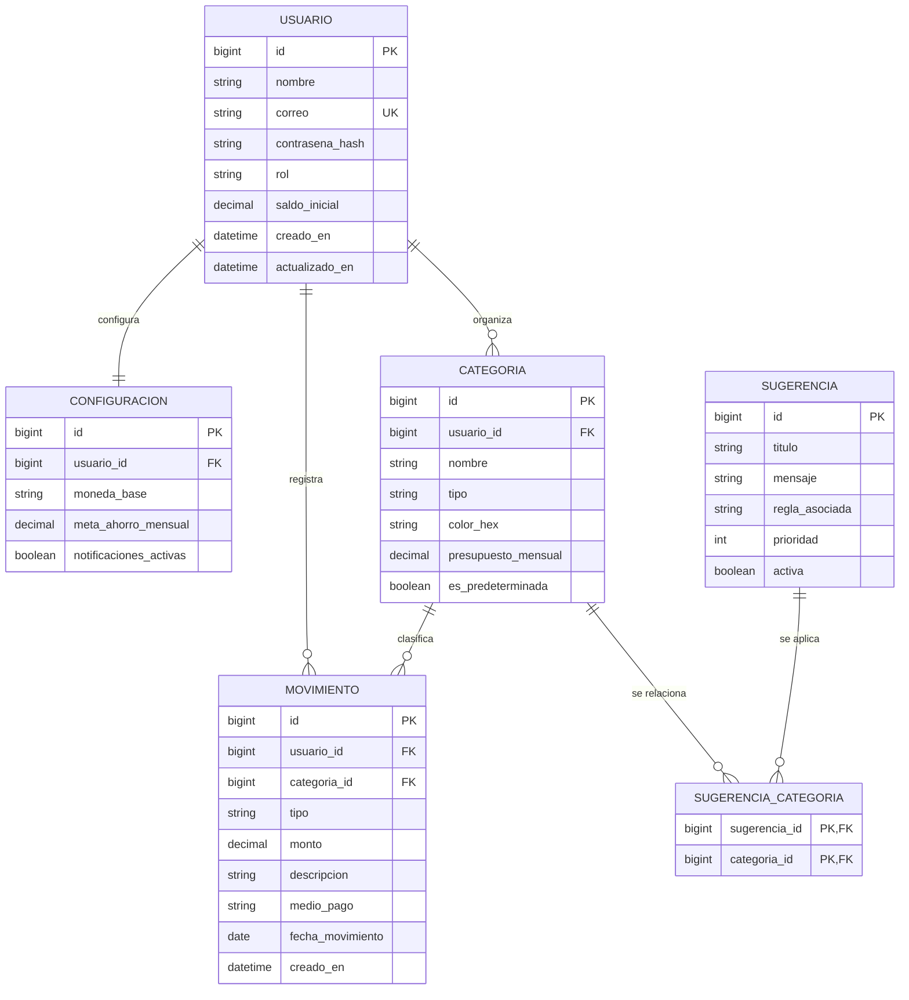
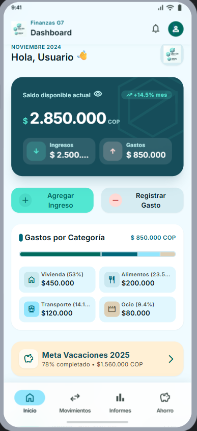
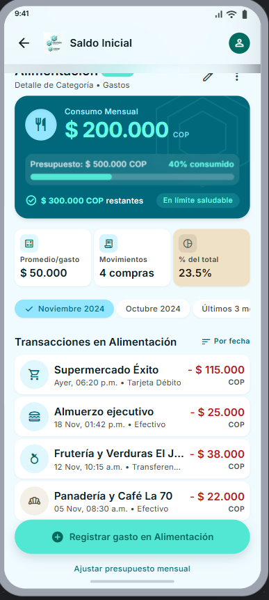
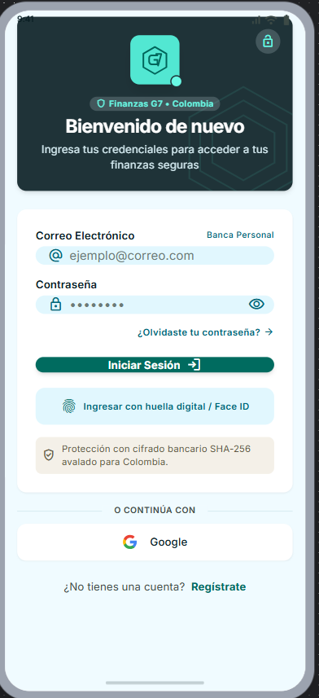
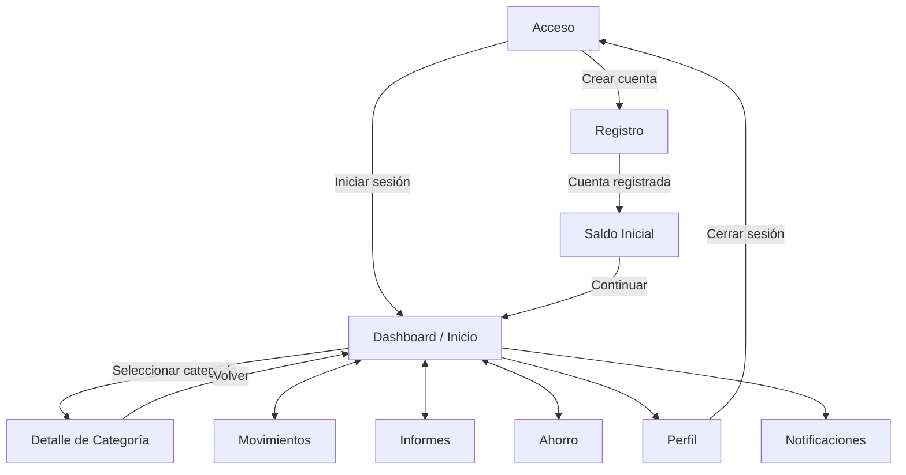
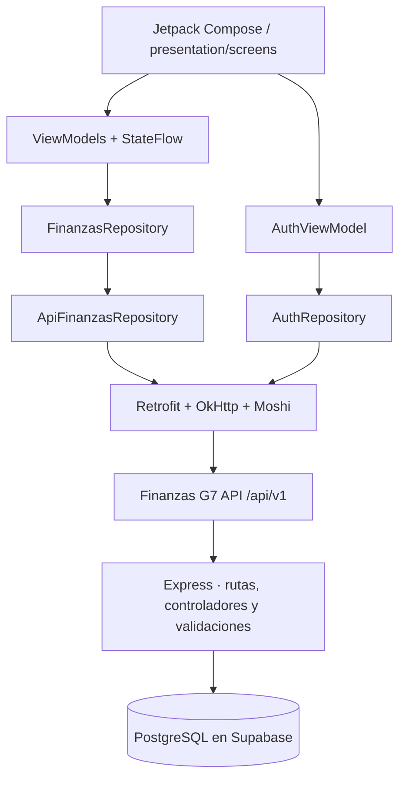

<div align="center">

# Proyecto Integrador Móviles G7

### Aplicación móvil para la gestión y análisis de finanzas personales

[](https://developer.android.com/)
[](https://kotlinlang.org/)
[](https://developer.android.com/compose)
[](https://gradle.org/)
[](#api-propia-finanzas-g7-api)
[](#arquitectura-y-consumo-de-la-api)
[](#api-propia-finanzas-g7-api)
[](https://github.com/JuanEstebanLT/proyectointegradormoviles-g7)

</div>

---


## Descripción

**Finanzas G7** es una aplicación Android para llevar el control manual de las finanzas personales. Permite consultar el saldo, registrar ingresos y gastos, organizar movimientos por categorías y revisar el historial financiero desde una interfaz desarrollada con Jetpack Compose.

El proyecto integra una aplicación **Kotlin con arquitectura MVVM** y una **API REST propia** desarrollada con Node.js y Express, que utiliza PostgreSQL en Supabase. El código de la aplicación, la navegación y la integración HTTP se encuentran incorporados en la rama principal del repositorio.

> [!NOTE]
> **Actualización del 12 de noviembre de 2026.** La API y el esquema SQL oficiales corresponden al desarrollo de **Emmanuel Villa**, integrado mediante el [PR #49](https://github.com/JuanEstebanLT/proyectointegradormoviles-g7/pull/49). No se utiliza la base de datos alternativa preparada anteriormente. El equipo informa que realizó las pruebas funcionales de su entorno; los resultados y evidencias deben conservarse en el proceso de QA. La publicación de un release estable en GitHub es una actividad independiente.

## Objetivo

Permitir que una persona lleve control manual de su dinero registrando saldo inicial, ingresos y gastos, para consultar posteriormente su situación financiera, historial, distribución de gastos e informes, junto con orientaciones educativas básicas sobre hábitos de ahorro.

## Tabla de contenido

- [Funcionalidades del MVP](#funcionalidades-del-mvp)
- [Alcance del MVP](#alcance-del-mvp)
- [Fuera del alcance](#fuera-del-alcance)
- [API propia: Finanzas G7 API](#api-propia-finanzas-g7-api)
- [Modelo de datos (Diagrama ER)](#modelo-de-datos-diagrama-er)
- [Diseño de pantallas y flujo de navegación](#diseño-de-pantallas-y-flujo-de-navegación)
- [Arquitectura y consumo de la API](#arquitectura-y-consumo-de-la-api)
- [Tecnologías](#tecnologías)
- [Estado actual del proyecto](#estado-actual-del-proyecto)
- [Historias de Usuario](#historias-de-usuario)
- [Gestión del proyecto](#gestión-del-proyecto)
- [Flujo de trabajo](#flujo-de-trabajo)
- [Equipo](#equipo)
- [Estrategia de ramas](#estrategia-de-ramas)
- [Convención de commits](#convención-de-commits)
- [Estructura documental](#estructura-documental)
- [Requisitos de desarrollo](#requisitos-de-desarrollo)
- [Instalación y clonación](#instalación-y-clonación)
- [Colaboración](#colaboración)
- [Enlaces del proyecto](#enlaces-del-proyecto)


## Funcionalidades del MVP

La aplicación y la API contemplan:

- Registro de cuentas e inicio de sesión mediante la autenticación propia de la API.
- Configuración del saldo inicial y consulta del saldo disponible.
- Registro de ingresos y gastos asociados a una categoría.
- Consulta de movimientos, filtrado por tipo y eliminación con confirmación.
- Visualización de ingresos, gastos, categorías y resumen financiero.
- Navegación entre Inicio, Movimientos, Informes, Ahorro, Perfil y Notificaciones.
- Servicios de categorías, configuración, resumen, sugerencias y edición de movimientos disponibles en el backend.

Algunas acciones siguen en evolución en la interfaz móvil, como la edición de movimientos, la modificación del presupuesto por categoría y el consumo directo de los endpoints de informes y sugerencias. La existencia del endpoint no implica que todas sus funciones ya estén conectadas desde Android.

## Alcance del MVP

| Área | Implementación |
|---|---|
| Presentación | Pantallas Kotlin/Jetpack Compose basadas en prototipos de Google Stitch |
| Arquitectura | MVVM; ViewModels, StateFlow y repositorio de sesión compartida |
| Navegación | Navigation Compose con destinos para los principales módulos |
| Comunicación | Retrofit, OkHttp, Moshi y DTO para la API propia |
| Backend | API REST Express bajo `/api/v1` |
| Datos | PostgreSQL en Supabase, mediante el esquema y las consultas de la API oficial |
| Seguridad | Autenticación JWT propia; control de acceso en la API |
| Calidad | Pruebas funcionales reportadas por el equipo y suite Android versionada; seguimiento mediante Issues y QA |

## Fuera del alcance

El MVP actual no contempla:

- Integración bancaria o conexión automática con entidades financieras.
- Pagos o transferencias desde la aplicación.
- Créditos, inversiones o criptomonedas.
- Recomendación de productos financieros.
- Asesoría financiera profesional.
- Consumo de APIs de terceros ajenas al proyecto.

Las sugerencias de ahorro tendrán un propósito exclusivamente educativo y se basarán en patrones simples de los movimientos registrados.

> [!NOTE]
> La exclusión de servicios externos se mantiene. La API consumida por la aplicación es propia del equipo y forma parte del alcance del proyecto, no una integración de terceros.


## API propia: Finanzas G7 API

El backend oficial fue desarrollado por **Emmanuel Villa** e integrado a `main` mediante el [PR #49](https://github.com/JuanEstebanLT/proyectointegradormoviles-g7/pull/49). Su implementación se encuentra en [`api/`](api/), separada del módulo Android [`app/`](app/).

### Justificación

La información financiera registrada pertenece a cada usuario. Una API propia permite administrar cuentas, categorías, movimientos y cálculos mediante un contrato REST, manteniendo separadas la presentación móvil, las reglas del servidor y el almacenamiento de datos.

### Información técnica

| Elemento | Implementación |
|---|---|
| Framework | Node.js y Express 5 |
| Base de datos | PostgreSQL mediante Supabase |
| Tablas del esquema oficial | `usuario`, `configuracion`, `categoria`, `movimiento`, `sugerencia` y `sugerencia_categoria` |
| Identificadores del esquema oficial | `BIGINT` |
| Autenticación | Contraseñas con hash bcrypt y tokens JWT emitidos por la API |
| Validación | Zod |
| Prefijo REST | `/api/v1` |
| Formato | JSON |
| Configuración privada | `SUPABASE_URL`, `SUPABASE_SERVICE_ROLE_KEY` y `JWT_SECRET` en el servidor |
| Ejecución local | `http://localhost:3000/api/v1`, según `api/README.md` |

> [!IMPORTANT]
> **Supabase se utiliza como base de datos PostgreSQL, no como proveedor de inicio de sesión en esta implementación.** El backend usa autenticación propia y accede a la base con una clave de servicio que nunca debe incluirse en Android ni en GitHub. La base de datos alternativa de fases anteriores no forma parte del contrato oficial.

### Recursos de la API

| Recurso | Ruta base | Operaciones disponibles |
|---|---|---|
| Usuarios y sesiones | `/api/v1/usuarios` | Registro, inicio de sesión, consulta y actualización |
| Configuración | `/api/v1/usuarios/{id}/configuracion` | Consultar y actualizar |
| Categorías | `/api/v1/categorias` | Crear, listar, consultar, editar y eliminar |
| Movimientos | `/api/v1/movimientos` | Crear, listar, consultar, editar y eliminar |
| Resumen | `/api/v1/resumen` | Consultar totales y saldo disponible |
| Sugerencias | `/api/v1/sugerencias` | Consultar orientaciones educativas |
| Salud | `/api/v1/salud` | Comprobar que responde el servidor |

La descripción completa de parámetros, respuestas, requisitos de configuración y pruebas manuales se encuentra en [`api/README.md`](api/README.md).

### Seguridad y administración de datos

El backend utiliza JWT para identificar al usuario y verificar permisos, distingue los roles `USUARIO` y `ADMIN` y valida las entradas antes de ejecutar operaciones. Las tablas SQL del backend están configuradas con RLS habilitado, mientras que el cliente del servidor utiliza `service_role` y realiza comprobaciones explícitas de pertenencia en las consultas.

La aplicación Android **no contiene claves de Supabase**: consume únicamente la API mediante Retrofit. La URL base de desarrollo se define en `local.properties`. Las credenciales privadas se mantienen fuera del repositorio y no deben adjuntarse a Issues, capturas ni Pull Requests.


## Modelo de datos (Diagrama ER)

El modelo siguiente representa el esquema definido en [`api/database/schema.sql`](api/database/schema.sql). Los identificadores SQL utilizados por este backend son numéricos (`BIGINT`), y las relaciones conservan la separación de información por usuario.



### Reglas de integridad

- Cada movimiento pertenece a un usuario y a una categoría.
- El tipo `INGRESO` o `GASTO` del movimiento debe coincidir con el de la categoría.
- La tabla `sugerencia_categoria` representa la asociación N:M entre categorías y sugerencias.
- Los importes se almacenan en columnas `NUMERIC` y las fechas de movimientos en columnas `DATE`.
- El disparador de inicialización crea configuración y categorías predeterminadas para los nuevos usuarios.

La fuente de referencia para la estructura física es el script SQL del backend, no las propuestas históricas del README.


## Diseño de pantallas y flujo de navegación

El diseño visual fue realizado en **Google Stitch** y trasladado a la capa `presentation/screens` de la aplicación Android.

**Prototipo de referencia:** [Finanzas G7 en Google Stitch](https://stitch.withgoogle.com/preview/12478822216412901322?node-id=7d4f7b7b00ad42a0af3af3ec48ea438e)

### Identidad visual

| Elemento | Definición |
|---|---|
| Nombre comercial | Finanzas G7 |
| Eslogan | Control inteligente de tu dinero |
| Color primario | Verde azulado oscuro |
| Color de acento | Turquesa |
| Moneda | Pesos colombianos (COP) |
| Navegación inferior | Inicio, Movimientos, Informes y Ahorro |

### Pantallas principales

#### Pantalla 1 — Dashboard



La pantalla inicial presenta el saldo disponible, el resumen de ingresos y gastos, los movimientos recientes y las categorías. Los datos observables provienen del `DashboardViewModel` y del repositorio financiero compartido. Permite iniciar el registro de movimientos y navegar al detalle de una categoría.

#### Pantalla 2 — Detalle de Categoría



Muestra datos de la categoría seleccionada, movimientos asociados, indicadores financieros y presupuesto. Recibe el identificador `categoriaId` mediante Navigation Compose. Algunas acciones de edición de categoría y ajuste de presupuesto aún conservan un comportamiento provisional.

#### Pantalla 3 — Acceso



Presenta el inicio de sesión con correo y contraseña, enlazado a `POST /api/v1/usuarios/sesion`. Incluye acceso al registro de usuario. Las opciones de recuperación de contraseña, acceso biométrico y proveedor externo permanecen como controles no implementados.

### Otras pantallas y módulos

| Vista o módulo | Estado del código |
|---|---|
| Registro | `RegistroScreen.kt`; registro mediante la API |
| Saldo Inicial | `SaldoInicialScreen.kt`; guarda mediante el repositorio financiero |
| Movimientos | Sección disponible con historial, filtros básicos, registro y eliminación |
| Informes | Sección disponible con cálculos sobre el estado financiero cargado |
| Ahorro | Sección disponible con orientación educativa general |
| Perfil | Visualización de información del usuario y cierre de sesión |
| Notificaciones | Destino disponible; servicio de notificaciones pendiente |
| Splash / Bienvenida | Parte del diseño conceptual; no son destinos independientes del `NavHost` actual |

### Flujo de navegación implementado



Las rutas se encuentran en [`NavegacionApp.kt`](app/src/main/java/com/example/proyecto_integrador_moviles_g7/presentation/navigation/NavegacionApp.kt). El PR [#48](https://github.com/JuanEstebanLT/proyectointegradormoviles-g7/pull/48) incorporó la navegación funcional.

### Aspectos pendientes en la interfaz

El backend ofrece endpoints adicionales que todavía no están consumidos de forma independiente desde todas las pantallas móviles: edición completa de movimientos y categorías, consulta específica de `/resumen` y recuperación de `/sugerencias`. Su finalización y validación se controlan mediante las historias y tareas correspondientes en GitHub.

Las imágenes `imagenes/pantalla_1.png`, `pantalla_2.png` y `pantalla_3.png` se conservan como referencias del diseño original; no deben interpretarse como capturas de ejecución de la versión actual.


## Arquitectura y consumo de la API

La aplicación sigue **MVVM (Model–View–ViewModel)**. La interfaz se desarrolla con Jetpack Compose; los ViewModels exponen `StateFlow` y delegan la lectura y escritura de datos en una implementación del contrato `FinanzasRepository`. La sesión utiliza un repositorio compartido para mantener coherencia entre pantallas.

### Arquitectura actual



### Componentes del repositorio

| Capa | Paquetes o archivos relevantes | Responsabilidad |
|---|---|---|
| Interfaz | `presentation/screens`, `presentation/components` | Vistas y eventos de usuario |
| Navegación | `presentation/navigation/NavegacionApp.kt` | Destinos y transición entre pantallas |
| ViewModel | `presentation/viewmodel` | Estado reactivo y coordinación de acciones |
| Modelo | `data/model` | Objetos de dominio financiero |
| Acceso a datos | `data/repository` | Abstracción del origen de información |
| Red | `data/network` y `data/api` | Cliente Retrofit y sesión HTTP |
| Transferencia | `data/dto` | Adaptación del contrato JSON |
| Backend | `api/src/routes`, `controllers`, `schemas` | Endpoints, validaciones y lógica del servidor |
| Base de datos | `api/database` | Esquema SQL, datos iniciales y migraciones |

### Integración Android–API

La integración con el backend está implementada mediante `ClienteApi.kt` y `FinanzasApiService.kt`. Las operaciones que utiliza el cliente actualmente son:

| Método | Endpoint | Uso en Android |
|---|---|---|
| `POST` | `/usuarios` | Crear cuenta |
| `POST` | `/usuarios/sesion` | Iniciar sesión |
| `GET` | `/usuarios/{id}` | Obtener datos de la cuenta |
| `PUT` | `/usuarios/{id}` | Actualizar saldo inicial |
| `GET` | `/categorias` | Cargar categorías |
| `GET` | `/movimientos` | Cargar movimientos |
| `POST` | `/movimientos` | Registrar ingreso o gasto |
| `DELETE` | `/movimientos/{id}` | Eliminar movimiento |

Todas estas rutas usan el prefijo `/api/v1`. El backend dispone de operaciones adicionales documentadas en [`api/README.md`](api/README.md).

### Estado y almacenamiento

`FinanzasSessionViewModel` mantiene `ApiFinanzasRepository` durante la sesión. El estado financiero observado se representa con `FinanzasState` y `StateFlow`. El repositorio en memoria se conserva para datos y pruebas locales, pero el flujo principal de la aplicación utiliza la implementación de API.

La sesión de acceso (`SesionActual`) conserva el JWT en memoria. Esto significa que al finalizar el proceso de la aplicación se debe volver a iniciar sesión. No está implementado un almacenamiento local persistente con Room ni DataStore.

La API gestiona las escrituras remotas y las pantallas se actualizan desde el estado compartido. La carga de movimientos tiene un límite de registros por solicitud; la paginación y el uso de resúmenes del servidor son puntos a considerar cuando aumente el volumen de información.

### Configuración de comunicación

En desarrollo Android, la dirección de la API se define en `local.properties`, ignorado por Git:

```properties
API_BASE_URL=http://10.0.2.2:3000/api/v1
```

La IP `10.0.2.2` permite que el emulador Android acceda al servidor ejecutado en el equipo local. Para un dispositivo físico se utiliza la IP alcanzable del equipo servidor. En producción debe configurarse una URL HTTPS válida.

Las claves privadas de Supabase y la firma de JWT se configuran únicamente en el entorno del backend. No deben introducirse en el código de la aplicación Android.


## Tecnologías

| Tecnología | Uso actual |
|---|---|
| Android Studio | Desarrollo y ejecución del cliente móvil |
| Kotlin | Código de la aplicación |
| Jetpack Compose y Material 3 | Construcción de interfaces |
| Navigation Compose | Navegación entre destinos |
| MVVM y StateFlow | Separación de responsabilidades y estado observable |
| Kotlin Coroutines | Operaciones asíncronas |
| Retrofit, OkHttp y Moshi | Consumo HTTP y serialización JSON |
| Gradle | Construcción y pruebas Android |
| Node.js y Express 5 | API REST del equipo |
| Zod | Validación del backend |
| PostgreSQL y Supabase | Persistencia de datos del backend |
| bcryptjs y jsonwebtoken | Autenticación propia de la API |
| Git y GitHub | Versionado, colaboración, Pull Requests e Issues |
| Google Stitch | Diseño inicial de la interfaz |

No se utilizan Room, DataStore, Hilt ni Coil como componentes implementados del cliente actual.

## Estado actual del proyecto

**Corte de seguimiento: 12 de noviembre de 2026.**

| Elemento | Estado |
|---|---|
| Repositorio y control de versiones | Configurado |
| Protección de `main` mediante reglas de GitHub | Activa |
| Equipo, tablero e historias de usuario | Organizados en GitHub |
| Vistas de Jetpack Compose | Incorporadas en `main` (PR #40) |
| Estructura MVVM | Incorporada (PR #38) |
| ViewModels y estado compartido | Integrados (PR #42 y PR #44) |
| Navegación de pantallas | Incorporada (PR #48) |
| API REST y capa HTTP Android | Integradas en el repositorio (PR #49) |
| Modelo SQL de la API oficial | Disponible en `api/database` |
| Pruebas funcionales del entorno del equipo | Realizadas, según validación del equipo |
| Evidencias de QA y cierre de Issues | En seguimiento |
| Publicación de un release estable en GitHub | Pendiente |

> [!NOTE]
> El equipo confirmó la ejecución satisfactoria de pruebas funcionales. Este README registra el estado reportado y los componentes que constan en el repositorio; no sustituye el informe de QA ni la evidencia de un despliegue público.


## Historias de Usuario

Las nueve historias funcionales del MVP permanecen registradas en GitHub para mantener trazabilidad de desarrollo, pruebas y criterios de aceptación.

| ID | Issue | Historia |
|---|---|---|
| HU-01 | [#8](https://github.com/JuanEstebanLT/proyectointegradormoviles-g7/issues/8) | Registrar saldo inicial |
| HU-02 | [#10](https://github.com/JuanEstebanLT/proyectointegradormoviles-g7/issues/10) | Registrar ingresos |
| HU-03 | [#6](https://github.com/JuanEstebanLT/proyectointegradormoviles-g7/issues/6) | Registrar gastos |
| HU-04 | [#5](https://github.com/JuanEstebanLT/proyectointegradormoviles-g7/issues/5) | Clasificar movimientos por categorías |
| HU-05 | [#1](https://github.com/JuanEstebanLT/proyectointegradormoviles-g7/issues/1) | Consultar saldo y resumen financiero |
| HU-06 | [#9](https://github.com/JuanEstebanLT/proyectointegradormoviles-g7/issues/9) | Consultar historial |
| HU-07 | [#7](https://github.com/JuanEstebanLT/proyectointegradormoviles-g7/issues/7) | Visualizar informes |
| HU-08 | [#3](https://github.com/JuanEstebanLT/proyectointegradormoviles-g7/issues/3) | Recibir sugerencias de ahorro |
| HU-09 | [#11](https://github.com/JuanEstebanLT/proyectointegradormoviles-g7/issues/11) | Editar y eliminar movimientos |

### Integraciones y tareas técnicas recientes

| Trabajo | Referencia | Resultado |
|---|---|---|
| Estructura MVVM | [#37](https://github.com/JuanEstebanLT/proyectointegradormoviles-g7/issues/37) / [PR #38](https://github.com/JuanEstebanLT/proyectointegradormoviles-g7/pull/38) | Integrado |
| Vistas basadas en Stitch | [#39](https://github.com/JuanEstebanLT/proyectointegradormoviles-g7/issues/39) / [PR #40](https://github.com/JuanEstebanLT/proyectointegradormoviles-g7/pull/40) | Integrado |
| ViewModels y StateFlow | [#41](https://github.com/JuanEstebanLT/proyectointegradormoviles-g7/issues/41) / [PR #42](https://github.com/JuanEstebanLT/proyectointegradormoviles-g7/pull/42) | Integrado |
| Sincronización MVVM | [#43](https://github.com/JuanEstebanLT/proyectointegradormoviles-g7/issues/43) / [PR #44](https://github.com/JuanEstebanLT/proyectointegradormoviles-g7/pull/44) | Integrado |
| Navegación | [#47](https://github.com/JuanEstebanLT/proyectointegradormoviles-g7/issues/47) / [PR #48](https://github.com/JuanEstebanLT/proyectointegradormoviles-g7/pull/48) | Integrado |
| API REST oficial | [#45](https://github.com/JuanEstebanLT/proyectointegradormoviles-g7/issues/45) / [PR #49](https://github.com/JuanEstebanLT/proyectointegradormoviles-g7/pull/49) | Integrado |

El [PR #46](https://github.com/JuanEstebanLT/proyectointegradormoviles-g7/pull/46) corresponde a una implementación alternativa de backend que fue cerrada sin fusionarse y **no** forma parte de la versión oficial.


## Gestión del proyecto

La planificación se administra en [Proyecto Integrador Móviles G7 — GitHub Project #6](https://github.com/users/JuanEstebanLT/projects/6), con el milestone [MVP v1.0 - Control financiero personal](https://github.com/JuanEstebanLT/proyectointegradormoviles-g7/milestone/1).

El backlog inicial se organizó en **9 historias de usuario y 14 tareas técnicas**; posteriormente se crearon Issues específicos para arquitectura, pantallas, navegación e implementación de la API. Los Issues se conservan para documentar tanto el trabajo incorporado como las verificaciones o mejoras pendientes.

Los estados del tablero son: `Backlog` → `Ready` → `In Progress` → `In Review` → `QA` → `Done`.

La revisión de resultados, el seguimiento del MVP y la aprobación de cambios se coordinan desde GitHub.

## Flujo de trabajo

Cada cambio debe mantener trazabilidad con un Issue y seguir este flujo:

```text
Issue
  ↓
Rama
  ↓
Desarrollo
  ↓
Commit
  ↓
Push
  ↓
Pull Request
  ↓
In Review
  ↓
QA
  ↓
Merge
  ↓
Done
```

No se debe desarrollar directamente sobre `main`. Cada Pull Request debe estar vinculado a su Issue, presentar un alcance acotado y superar revisión y QA antes de integrarse.


## Equipo

| Integrante | Responsabilidad |
|---|---|
| **Juan Esteban Lezcano Tejada** | Líder de desarrollo y aseguramiento de calidad (QA) |
| **Emmanuel Villa** | Desarrollo de API REST e integración del backend |
| **Juan Bastidas** | Desarrollo Android y navegación |
| **Mariana Suarez Higuita** | Estructura MVVM, ViewModels y estado de la aplicación |

## Estrategia de ramas

`main` es la rama oficial y se encuentra protegida. El desarrollo se realiza en ramas temporales asociadas a una tarea o corrección y se incorpora mediante Pull Request.

```text
feat/<issue>-descripcion
fix/<issue>-descripcion
docs/<issue>-descripcion
test/<issue>-descripcion
```

Las ramas personales y las ramas temporales de trabajos terminados no son necesarias para el flujo actual. Se deben eliminar cuando sus aportes hayan sido integrados o descartados, sin perder la trazabilidad de los Pull Requests.

## Convención de commits

Se utiliza una convención breve basada en el tipo de cambio:

| Prefijo | Uso |
|---|---|
| `feat:` | Nueva funcionalidad |
| `fix:` | Corrección de un defecto |
| `test:` | Creación o actualización de pruebas |
| `docs:` | Cambios de documentación |
| `refactor:` | Mejora interna sin cambiar el comportamiento esperado |
| `chore:` | Mantenimiento o configuración |

Formato recomendado:

```text
tipo(alcance): descripción breve (#issue)
```

Ejemplo:

```text
feat(finanzas): implementar registro de saldo inicial (#14)
```

## Estructura documental

La documentación de apoyo se organiza por áreas de trabajo. La siguiente clasificación describe el esquema documental del equipo y **no** representa carpetas existentes dentro de este repositorio:

```text
00_Gobierno_Documental
01_Inicio_y_Planeacion
02_Requerimientos
03_Diseño
04_Calidad
05_Manuales
06_Cierre
07_Evaluacion
08_Repositorio
```

Esta documentación reúne gobierno documental, planeación, requisitos, propuestas de diseño, matrices de calidad, manuales, plantillas de cierre, evaluación y lineamientos del repositorio.

El diagrama entidad-relación de la API propia corresponde al área `03_Diseño`.


## Requisitos de desarrollo

- Git y Android Studio.
- Android SDK y JDK compatibles con el Gradle Wrapper del proyecto.
- Node.js 20 o superior para el backend.
- Acceso al entorno de base de datos autorizado para ejecutar la API, sin publicar sus credenciales.
- Dirección de red de la API accesible desde el emulador o el dispositivo.

## Instalación y clonación

Clonar el proyecto:

```bat
git clone https://github.com/JuanEstebanLT/proyectointegradormoviles-g7.git
cd proyectointegradormoviles-g7
```

### Iniciar el backend

La API se encuentra en `api/`. Antes de ejecutarla se debe crear un archivo `api/.env` local con las variables `SUPABASE_URL`, `SUPABASE_SERVICE_ROLE_KEY` y `JWT_SECRET`, utilizando únicamente credenciales autorizadas. Ese archivo **no se publica**.

```bat
cd api
npm install
npm run dev
```

El endpoint de salud local es `http://localhost:3000/api/v1/salud`. La configuración completa de la base y los endpoints se documenta en [`api/README.md`](api/README.md).

### Configurar Android

Abrir el proyecto en Android Studio y permitir la sincronización de Gradle. En el archivo raíz `local.properties` agregar la dirección que corresponda al entorno de prueba. Para el emulador con la API ejecutándose en el mismo PC:

```properties
API_BASE_URL=http://10.0.2.2:3000/api/v1
```

Para un dispositivo físico, utilizar una IP local alcanzable. En un entorno publicado, usar HTTPS. `local.properties` queda excluido del control de versiones.

### Compilación y pruebas

En una nueva terminal, desde la raíz del repositorio:

```bat
gradlew.bat test
gradlew.bat build
```

El módulo Android contiene pruebas unitarias e instrumentadas. Los resultados funcionales del servidor y de la integración con la base deben documentarse en las evidencias de QA correspondientes. Los comandos de construcción no sustituyen las pruebas en dispositivo.

## Colaboración

Antes de comenzar un cambio:

1. Seleccionar o crear el Issue correspondiente.
2. Confirmar alcance, responsable, prioridad y dependencias.
3. Crear una rama específica relacionada con el Issue.
4. Mantener commits pequeños, claros y trazables.
5. Publicar la rama y abrir un Pull Request hacia `main`.
6. Atender observaciones de revisión.
7. Completar QA antes del merge.
8. Integrar únicamente mediante un Pull Request aprobado.

## Enlaces del proyecto

- [Repositorio oficial](https://github.com/JuanEstebanLT/proyectointegradormoviles-g7)
- [GitHub Project #6](https://github.com/users/JuanEstebanLT/projects/6)
- [Milestone MVP v1.0 - Control financiero personal](https://github.com/JuanEstebanLT/proyectointegradormoviles-g7/milestone/1)
- [Issues del proyecto](https://github.com/JuanEstebanLT/proyectointegradormoviles-g7/issues)

---

<div align="center">

**Equipo de Desarrollo Móviles G7**<br>
Proyecto Integrador Móviles G7

</div>
